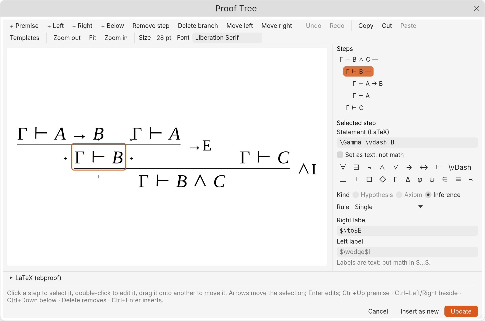
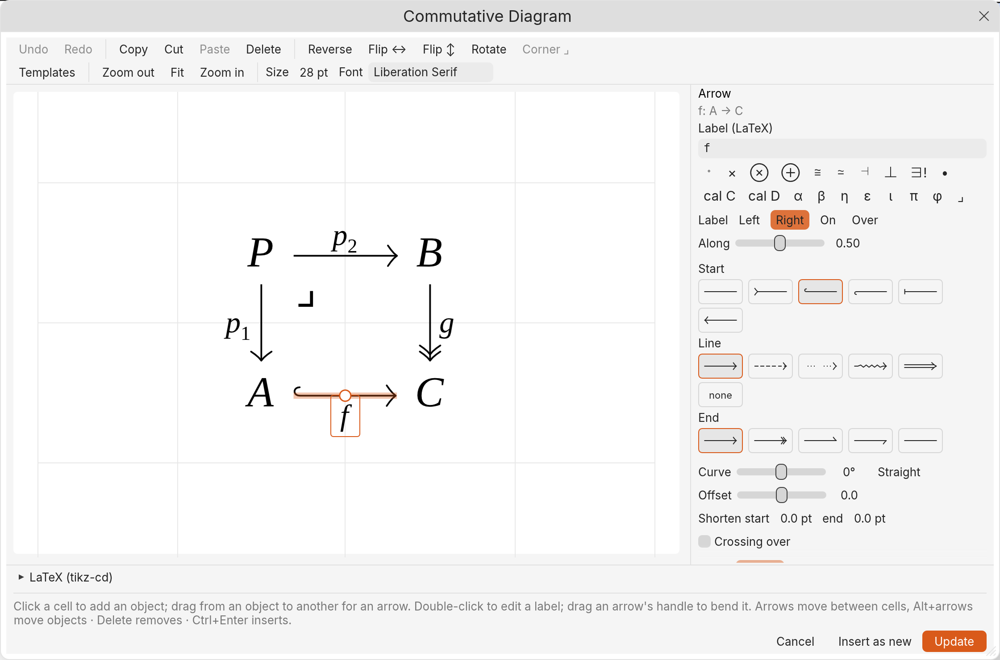
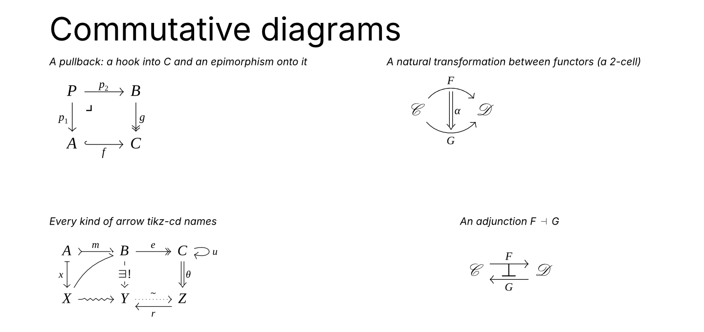
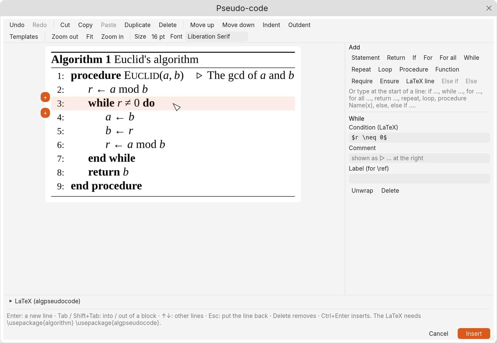
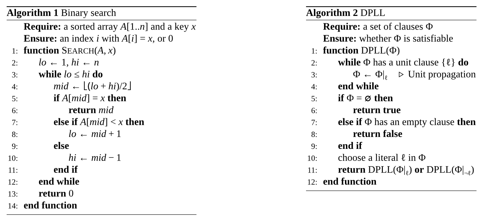
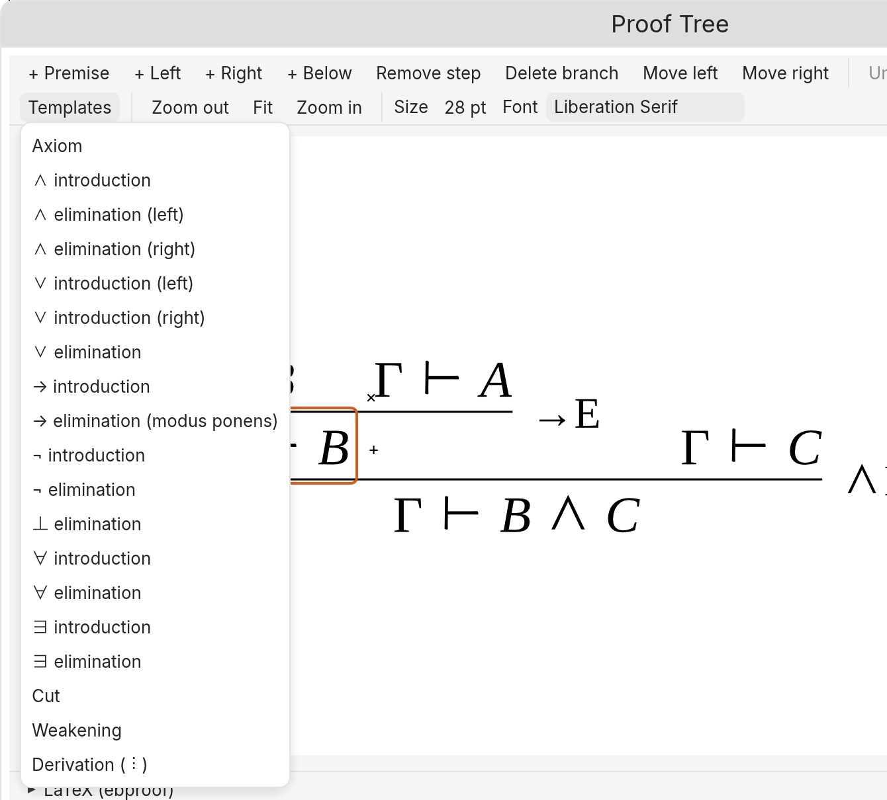
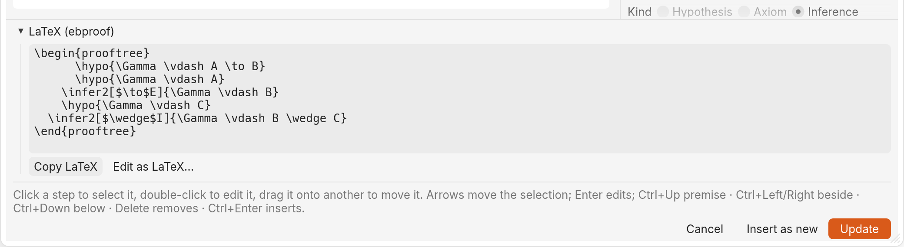
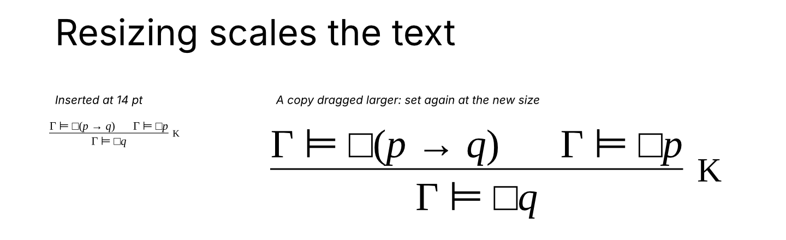
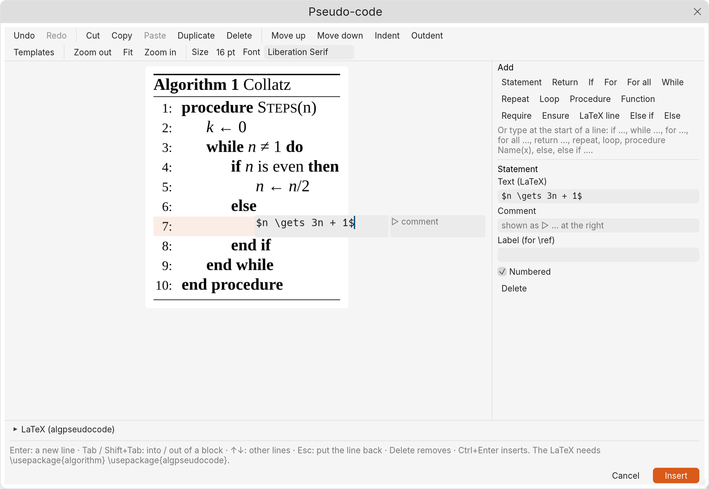

<p align="center">
  <picture>
    <source media="(prefers-color-scheme: dark)" srcset="docs/brand/logicians-logo-white.svg">
    
  </picture>
</p>

<h1 align="center">DeckCraft Logicians Edition</h1>

<p align="center">
  <b>Presentations and slide shows for logicians: an open-source, modern presentation designer built in pure Rust.</b>
</p>

<p align="center">
  DeckCraft Logicians Edition is a modified version of DeckCraft for practitioners of logic,
  mathematics and computer science. Build decks with <strong>typeset LaTeX that knows the symbols of
  logic</strong> (⊢ ⊨ ∀ ∃ ¬ □ ⊥ …), <strong>proof trees</strong> written in ebproof, bussproofs,
  mathpartir or proof.sty syntax or built step by step in a visual Proof Tree builder,
  <strong>commutative diagrams</strong> in tikz-cd drawn on a grid in the manner of quiver, and
  <strong>pseudo-code</strong> in algpseudocode written line by line in the Pseudo-code tool. Each
  keeps its LaTeX, ready to copy into your paper. As in DeckCraft, you also get themes, layouts,
  shapes, pictures, tables, charts, transitions and animations, .pptx files and full-screen
  presenting, natively on macOS, Windows, Linux and FreeBSD, and in the browser. Every button is
  also a command that the CLI and AI agents (through MCP) can drive.
</p>

<p align="center">
  
  
  
  
  <br>
  <a href="https://sonarcloud.io/project/overview?id=storytold_deckcraft"></a>
  <a href="https://coderabbit.ai"></a>
</p>

> [!NOTE]
> **DeckCraft Logicians Edition is a modified version of DeckCraft.** It is based on
> [DeckCraft](https://github.com/storytold/deckcraft) by the ArtCraft team, and adds typeset LaTeX,
> proof trees, commutative diagrams and pseudo-code. It is not made, endorsed or supported by the ArtCraft
> team; report its problems here rather than to DeckCraft.

<p align="center">
  
</p>

<p align="center">
  <a href="#what-works-today">What works</a> ·
  <a href="#getting-started">Getting started</a> ·
  <a href="#tutorial-latex-equations-proof-trees-diagrams-and-pseudo-code">LaTeX, diagrams and pseudo-code</a> ·
  <a href="#agents-cli-and-mcp">Agents, CLI and MCP</a> ·
  <a href="#roadmap">Roadmap</a> ·
  <a href="#downloads">Downloads</a> ·
  <a href="#based-on-deckcraft">Based on DeckCraft</a> ·
  <a href="#license-and-credits">License</a>
</p>

## What works today

DeckCraft is in alpha, heading for beta (see the [roadmap](ROADMAP.md)).
Today it can:

- **Typeset math and logic** (this edition): LaTeX formulas with the symbols of logic, arrays
  and truth tables, aligned derivations, and Office equations, also inside a line of text;
  proof trees in ebproof, bussproofs, mathpartir or proof.sty syntax, and a visual Proof Tree
  builder with templates for natural deduction; commutative diagrams in tikz-cd, with a grid
  editor for objects, arrows, 2-cells, pullback corners and every tikz-cd arrow style; algorithms
  in algpseudocode (or the older algorithmic), typed line by line in the Pseudo-code tool with
  keywords that make their blocks, templates from Euclid to DPLL and resolution. All of them keep
  their LaTeX and scale with their box (see the
  [tutorial](#tutorial-latex-equations-proof-trees-diagrams-and-pseudo-code)).
- **Make decks**: slide masters and eleven layouts with placeholders that inherit position and
  formatting, eight original themes with colour and font schemes, sections, notes, comments,
  headers and footers, custom slide sizes.
- **Draw**: 150+ preset shapes with adjust handles, connectors that stay glued to shapes, freeform,
  curve and scribble tools, merge shapes (union, combine, fragment, intersect, subtract), gradient,
  picture and pattern fills, outlines with dashes and arrowheads, shadows, glow, soft edges and
  reflections.
- **Write**: in-place text editing with full font and paragraph formatting, bullets and numbering,
  columns, autofit, vertical text, fields and hyperlinks.
- **Add content**: pictures with crop and corrections, tables with styles, charts, SmartArt basics,
  audio and video (MP3, AAC, FLAC, ALAC, Ogg, Opus, WAV, AIFF; H.264, HEVC, VP9, AV1).
- **Present**: transitions (including Morph), entrance/emphasis/exit and motion-path animations,
  by-paragraph builds, full-screen slide show, presenter view, pen, rehearse timings, media playback.
- **Exchange files**: open and save .pptx presentations, export PDF (slides, notes pages, handouts
  with selectable text), PNG/JPEG, an animated GIF of the deck and outlines. Unsaved work is kept by AutoRecover.
- **Automate**: 200+ commands with undo, all scriptable from the CLI, a JSON control channel and an
  MCP server for AI agents, including `insert.latex`, `insert.equation`, `latex.get` and
  `latex.set` for LaTeX, proofs, diagrams and algorithms.

<table>
  <tr>
    <td width="50%"><br><sub>Typeset LaTeX: formulas, a truth table, a derivation, an equation in a sentence</sub></td>
    <td width="50%"><br><sub>The Proof Tree builder</sub></td>
  </tr>
  <tr>
    <td width="50%"><br><sub>The Commutative Diagram editor</sub></td>
    <td width="50%"><br><sub>Commutative diagrams on a slide</sub></td>
  </tr>
  <tr>
    <td width="50%"><br><sub>The Pseudo-code tool</sub></td>
    <td width="50%"><br><sub>Algorithms on a slide</sub></td>
  </tr>
</table>

<table>
  <tr>
    <td width="50%"><br><sub>Shape Format contextual tab and selection handles</sub></td>
    <td width="50%"><br><sub>Format Shape pane: gradient type, direction and stops</sub></td>
  </tr>
  <tr>
    <td width="50%"><br><sub>Slide Sorter with each slide's transition</sub></td>
    <td width="50%"><br><sub>Dark mode, with a native chart</sub></td>
  </tr>
</table>

<p align="center">
  <br>
  <sub>The built-in sample deck, rendered by <code>deckcraft-cli render --sample --all</code></sub>
</p>

## Getting started

PDF export uses the shared `craft-pdf` writer with import features disabled. See
[`crates/pdf/README.md`](crates/pdf/README.md) for the dependency and validation requirements.

```sh
git clone https://github.com/ruijiefang/deckcraft
cd deckcraft
cargo run --release -p deckcraft -- --sample            # the app, on the sample deck
cargo run --release -p deckcraft-cli -- render --sample --all --scale 1 out/
```

Then try **Insert ▸ Equation**, **Insert ▸ Proof Tree**, **Insert ▸ Commutative Diagram** and
**Insert ▸ Pseudo-code** (the [tutorial](#tutorial-latex-equations-proof-trees-diagrams-and-pseudo-code) walks through
them).

LaTeX is read by craft-math, from [craft-libs](https://github.com/storytold/craft-libs). The
names from amssymb and the logic packages (`\vDash` ⊨, `\nvdash` ⊬, `\Box` □, `\lrcorner` ⌟ for
pullback corners…) need craft-math changes that DeckCraft's pinned craft-libs doesn't have yet
(they are on craft-libs' `craft-math-latex-logic-symbols` branch, not yet published). Until the
pin moves, put a craft-libs checkout with those changes next to this repository and build with:

```sh
cargo build --release -p deckcraft -p deckcraft-cli \
  --config 'patch."https://github.com/storytold/craft-libs".craft-math.path="../craft-libs/crates/math"'
```

The patch rewrites `Cargo.lock`; restore it (`git checkout Cargo.lock`) rather than committing
it. Without the patch everything builds and works, and those names show as written.

On Linux, the build also needs the ALSA headers for slide-show sound: `alsa-lib-devel` on Fedora,
`libasound2-dev` on Debian and Ubuntu, `alsa-lib` on Arch. Without them it stops at `alsa-sys`.

Fonts come from [craft-fonts](https://github.com/storytold/craft-fonts): clone it next to this repo
(`../craft-fonts`) and local builds pick it up automatically; without it DeckCraft uses your system
fonts.

Each [GitHub release](https://github.com/storytold/deckcraft/releases) has ready-made builds, on Linux as
an AppImage, a `.deb`, an `.rpm` and a tarball. On Gentoo, the community [::snakebyte
overlay](https://github.com/switch87/snakebyte-overlay) packages the Linux release as
`app-office/deckcraft-bin` (not maintained by the DeckCraft team):

```sh
eselect repository add snakebyte git https://github.com/switch87/snakebyte-overlay.git
emaint sync -r snakebyte
echo 'app-office/deckcraft-bin ~amd64' >> /etc/portage/package.accept_keywords/deckcraft
emerge --ask app-office/deckcraft-bin
```

### Logs

The desktop app writes its `log` records to standard error and to `logs/deckcraft.log` in the
settings directory, beside `ui.json` and `prefs.json` (Linux `~/.config/deckcraft/logs/`, or
`$XDG_CONFIG_HOME/deckcraft/logs/`; macOS `~/Library/Application Support/DeckCraft/logs/`; Windows
`%APPDATA%\DeckCraft\logs\`). A start from a desktop menu or the Dock has no terminal, so this file
is what to attach to a bug report: the crash guard's panic report, a failed crash-recovery save,
Parts skipped on import and audio output problems land there. Each launch moves the
previous log to `deckcraft.1.log` (and that one to `deckcraft.2.log`), so the log of a run that
crashed survives the next start. The file stops growing at 16 MiB. `--version` writes no file.

| Variable | Effect |
|---|---|
| `RUST_LOG` | Log levels for standard error and the log file. Default: `info` for DeckCraft's own crates, `warn` for everything else. env_logger-style directives replace that, e.g. `RUST_LOG=debug`, `RUST_LOG=warn,deckcraft_pptx=trace` or `RUST_LOG=info,wgpu_core=warn`; a directive ending in `*` covers every target starting with it (`deckcraft*=debug`). |

The logger is `apps/deckcraft/src/logging.rs`; the realtime audio callback does not log. The web
app logs to the browser console instead.

## Tutorial: LaTeX equations, proof trees, diagrams and pseudo-code

DeckCraft sets LaTeX itself: formulas, arrays and tables, aligned derivations, proof trees,
commutative diagrams and algorithms become ordinary slide shapes (text boxes, rules and arrows in a group). They look the same in DeckCraft,
in exported PDFs and in PowerPoint, and they keep their LaTeX, so you can open them again and
change them. This tutorial walks through each part. Shortcuts are written with Ctrl; on macOS use ⌘.

<p align="center">
  <br>
  <sub>Everything starts on the Insert tab: <b>Equation</b>, <b>Proof Tree</b>, <b>Commutative Diagram</b> and <b>Pseudo-code</b></sub>
</p>

### 1. Insert a formula

1. Choose **Insert ▸ Equation**.
2. Type LaTeX, with or without `$…$`, `\[…\]` or `\begin{equation}`. **Enter** starts a new line,
   so long sources stay readable; **Ctrl+Enter** presses **Insert**.
3. Pick how it is inserted:
   - **Typeset by DeckCraft** (the default) sets it as shapes. Use this for logic, arrays and proofs.
   - **Office equation** inserts a native equation that PowerPoint edits in its own equation editor.
     DeckCraft draws its linear form (`(a+b)/2`), so prefer typeset when the slide is shown from
     DeckCraft or exported to PDF.

<p align="center">
  
</p>

The new shape lands in the middle of the slide, in 24 pt Liberation Serif; drag it where you want
it. The slide below was made this way (the captions are ordinary text boxes):

<p align="center">
  
</p>

What you can write:

| | Examples |
|---|---|
| Logic | `\forall \exists \neg \lnot \wedge \land \vee \lor \to \rightarrow \leftrightarrow \iff \implies \vdash \nvdash \vDash \models \Vdash \bot \top \Box \Diamond \equiv`, and any relation negated with `\not` (`\not\models` gives ⊭) |
| Sets and order | `\in \notin \subseteq \subset \cup \cap \emptyset \setminus \leq \geq \neq \sqsubseteq \prec` |
| Letters | Greek (`\alpha … \Omega`, `\varphi`), `\mathbb{N}`, `\mathcal{L}`, `\mathfrak{g}`, `\mathbf{v}`, `\mathsf{Set}`, `\mathrm{d}`, `\text{if and only if}` |
| Structure | `x^2`, `x_i`, `\sum_{i=1}^{n}`, `\frac{a}{b}`, `\sqrt[3]{x}`, `\hat{x}`, `\bar{y}`, `\overset{\text{def}}{=}`, `\underset{x \in X}{\min}`, `\stackrel{?}{=}` |
| Spacing | `\,` `\:` `\;` `\quad` `\qquad` `~`; operators, relations and quantifiers are spaced as TeX spaces them |
| Grids | `array` (with `\|` column rules, `\hline`, `\cline{2-3}`, `\multicolumn`), `tabular`, `align`/`align*`/`aligned`/`alignat`/`split`/`eqnarray`, `gather`/`multline` |

The truth table above is:

```latex
\begin{array}{cc|c|c}
  p & q & p \wedge q & p \to q \\ \hline
  T & T & T & T \\
  T & F & F & F \\
  F & T & F & T \\
  F & F & F & T
\end{array}
```

### 2. Put an equation inside a sentence

While you are typing in a text box, **Insert ▸ Equation** puts the equation into the text at the
cursor, in the text's size. The dialog says so ("Goes into the text at the cursor"). Text you type
after it keeps the sentence's own font. The last line of the slide above, *Since Γ ⊬ ⊥, the theory
is consistent*, was typed this way.

<p align="center">
  
</p>

An inline equation is an Office equation, so PowerPoint can edit it too. A proof tree or an array
can't sit in a line of text: those are inserted as their own shape. To change an inline equation
later, select its text box (click its border), choose **Insert ▸ Equation** and keep **Change the
selected one** ticked: the dialog opens on the box's first equation.

### 3. Write proof trees in LaTeX

Paste a proof tree into **Insert ▸ Equation** in any of four common syntaxes. DeckCraft draws
the rules, labels and premises, and centres each conclusion under its premises.

<p align="center">
  
</p>

**ebproof**: `\hypo{…}` for a leaf, `\infer N[label]{conclusion}` for a rule with N premises
(`\infer0` is an axiom, `\infer{10}` takes ten), and the `left label`, `right label`,
`rule style=double|dashed|no rule` and `template` options. The older capitalised `\Hypo` and
`\Infer` work too, and the `prooftree` environment is optional.

```latex
\begin{prooftree}
  \hypo{\Gamma \vdash A}
  \hypo{\Gamma \vdash B}
  \infer2[$\wedge$I]{\Gamma \vdash A \wedge B}
  \infer1[$\wedge$E$_1$]{\Gamma \vdash A}
\end{prooftree}
```

**bussproofs**: `\AxiomC`, `\UnaryInfC` … `\QuinaryInfC` (and the short `\AXC`, `\UIC`, `\BIC`,
`\TIC`), `\LeftLabel`, `\RightLabel`, `\noLine`, `\doubleLine`, `\dashedLine`, `\DisplayProof`.

```latex
\AxiomC{$[A]^1$}
\noLine \UnaryInfC{$\vdots$}
\noLine \UnaryInfC{$B$}
\RightLabel{$\to$I$^1$}
\UnaryInfC{$A \to B$}
\DisplayProof
```

**mathpartir**: `\inferrule{premises separated by \\}{conclusion}` and
`\inferrule*[right=…, left=…]{…}{…}`.

```latex
\inferrule*[right=App]{\Gamma \vdash e_1 : A \to B \\ \Gamma \vdash e_2 : A}{\Gamma \vdash e_1\,e_2 : B}
```

**proof.sty**: `\infer[label]{conclusion}{premise & premise}`, `\infer=` for a double rule and
`\deduce` for a rule-less step.

```latex
\infer[\to E]{\Gamma \vdash B}{
  \infer{\Gamma \vdash A \to B}{\Gamma, A \vdash B} &
  \infer={\Gamma \vdash A}{\Gamma \vdash \neg\neg A}}
```

Several proofs in one source (for example two `prooftree` environments) are set side by side.

### 4. Build a proof tree visually

**Insert ▸ Proof Tree** opens the Proof Tree builder. You build the tree step by step and see it
typeset as you go; the builder writes the ebproof LaTeX for you.

<p align="center">
  
</p>

- **Canvas** (middle): click a step to select it, double-click to edit its statement, drag a step
  onto another to move it (onto the left or right quarter to put it beside, elsewhere to make it a
  premise). The selected step has buttons around it: **+** above adds a premise, **+** left and
  right add one beside, **+** below adds a step under it, **×** removes it.
- **Steps** (top right): the same tree as an outline; click to select.
- **Selected step**: its **Statement** in LaTeX (math by default; tick **Set as text, not math**
  for prose), a strip of common logic symbols to click in, its **Kind** (hypothesis, axiom or
  inference), its **Rule** (single, double, dashed, no rule, or an ellipsis ⋮) and its **Right
  label** and **Left label**. Labels are text: put math in `$…$`, as in `$\to$E`.
- **Toolbar**: the same edits as buttons, plus **Undo**/**Redo**, **Copy**/**Cut**/**Paste** of
  whole branches, **Templates**, zoom, and the **Size** and **Font** the proof is set in.
- **Footer**: **Insert** (or **Update** when you opened an existing proof), **Insert as new** to
  keep the original and add a copy, and **Cancel** (it asks before throwing changes away).

**Try it**: modus ponens from the keyboard.

1. **Insert ▸ Proof Tree**. The new proof starts in its conclusion's statement: type `B`.
2. **Ctrl+↑** adds a premise and puts you in it. Type `A \to B`.
3. **Tab** adds the next premise on the right. Type `A`.
4. Click the conclusion **B** and type `$\to$E` into **Right label**.
5. **Ctrl+Enter** inserts the proof on the slide.

| Keys | Does |
|---|---|
| Ctrl+↑ / Ctrl+↓ | Add a premise above the selected step / a step below it |
| Ctrl+← / Ctrl+→ | Add a premise beside it, on the left / right |
| Tab (while typing a statement) | Add the next premise on the right |
| ↑ ↓ ← → | Select the first premise, the step below, or the neighbour on either side |
| Enter or F2 | Edit the selected step's statement |
| Esc | In a statement: put it back as it was and leave the field. Elsewhere: close the builder |
| Delete | Remove the step; its premises take its place |
| Shift+Delete | Delete the step and everything above it |
| Alt+← / Alt+→ | Swap the step with its neighbour |
| Ctrl+Z, Ctrl+Shift+Z or Ctrl+Y | Undo, redo (the builder keeps its own history) |
| Ctrl+C / Ctrl+X / Ctrl+V | Copy, cut, paste a branch (pasted above the selected step) |
| Ctrl+Enter | Insert or Update, and close |

**Templates** insert a whole natural-deduction rule with placeholder statements: into an empty
step, above the selected step, or as a new tree. There are the introduction and elimination rules
for ∧, ∨, →, ¬, ∀ and ∃, ⊥ elimination, axiom, cut, weakening and a ⋮ derivation.

<p align="center">
  
</p>

The **LaTeX (ebproof)** pane under the canvas shows the source the builder writes. You can also
edit it there and the tree follows; **Copy LaTeX** puts it on the clipboard for your paper, and
**Edit as LaTeX…** moves to the Equation dialog. A proof first written in bussproofs, mathpartir or
proof.sty is rewritten in ebproof when you update it from the builder (the builder tells you so,
and says what it can't keep).

<p align="center">
  
</p>

### 5. Edit and resize

- **Double-click** a typeset formula or array to reopen it in the Equation dialog, with **Change
  the selected one** ticked so **Update** replaces it in place (untick it to insert a new copy).
  Double-click a proof tree to open it in the Proof Tree builder, a diagram to open it in the
  Commutative Diagram editor, and an algorithm to open it in the Pseudo-code tool; from the
  Equation dialog, **Open in Proof Tree builder**, **Open in diagram editor** and **Open in
  Pseudo-code tool** do the same. Each change is one step of the deck's undo.
- **Resize** a typeset shape with a corner handle. It keeps its proportions and is set again at the
  new size, so the text and rules stay sharp rather than stretched, and the new size is kept for
  the next edit.

<p align="center">
  
</p>

### 6. Draw commutative diagrams

**Insert ▸ Commutative Diagram** opens an editor for the diagrams of category theory: objects on a
grid and arrows between them, in the manner of quiver. DeckCraft draws the diagram itself,
following tikz-cd's spacing and arrow tips, so no TeX installation is needed. It keeps the
diagram as tikz-cd LaTeX, which compiles in your paper with `\usepackage{tikz-cd}`.

<p align="center">
  
</p>

On the grid:

- **Add an object**: click an empty cell. Its label starts as `\bullet` and is already selected,
  so type to replace it; click the next empty cell for the next object.
- **Add an arrow**: drag from one object to another. Drop it on an empty cell to add the object
  there too, back on the same object for a loop, or on an arrow for an arrow between arrows (a
  2-cell, drawn double, like a natural transformation).
- **Select**: click (Shift-click adds), or drag a box around several. Double-click an object or an
  arrow to type its label.
- **Move**: Alt-drag objects (or Alt+arrow keys); their arrows follow.
- **Shape an arrow**: drag the round handle in the middle of a selected arrow sideways to bend it,
  and drag its label along it or across to its other side.

What the side panel sets depends on the selection:

| Selected | You set |
|---|---|
| Nothing | Row and column spacing: tikz-cd's tiny, small, scriptsize, normal, large and huge, or a length in ems |
| An object | Its label (LaTeX, with a strip of common symbols: ∘ × ⊗ ≅ ⊣ ⊥ ∃! 𝒞 α…), a frame (none, box, circle) and a colour |
| An arrow | Its label, the label's side (left or right of the arrow, on it over a patch of background, or on it with nothing behind) and its place along the arrow; how it starts (nothing, ↣, a hook either way, ↦, an arrowhead), its line (solid, dashed, dotted, squiggly, double, or none for a label only) and how it ends (arrowhead, ↠, a harpoon either way, nothing), each picked from a picture of it; curve; offset (for parallel arrows); shortening at either end; width; colour; crossing over; and a loop's direction |

Several arrows or objects selected change together. The toolbar has **Undo**/**Redo**,
**Copy**/**Cut**/**Paste** (pasting at the selected cell; tikz-cd text from the clipboard pastes
too), **Delete**, **Reverse**, **Flip ↔**, **Flip ↕**, **Rotate**, **Corner ⌟** (marks the
selected object as a pullback or pushout corner), **Templates**, zoom, and the **Size** and
**Font** the diagram is set in. The templates are a commutative square, triangle, pullback,
pushout, product, coproduct, equalizer, span, cospan, adjunction, natural transformation, short
exact sequence, isomorphism and endomorphism.

| Keys | Does |
|---|---|
| Arrow keys | Move between cells (selecting the object there) |
| Alt+arrow keys | Move the selected objects a cell |
| Enter or F2 | Type the selected object's or arrow's label; on an empty cell, add an object |
| Delete | Delete the selection (and the arrows reaching it) |
| Ctrl+A, Ctrl+C / X / V | Select everything; copy, cut, paste |
| Ctrl+Z, Ctrl+Shift+Z or Ctrl+Y | Undo, redo |
| Esc | In a label: put it back as it was. Then: clear the selection. Then: close (asking first if anything changed) |
| Ctrl+Enter | Insert or Update, and close |

The **LaTeX (tikz-cd)** pane shows what the editor writes, and edits both ways: paste a diagram
from a paper, or from quiver's LaTeX export, and the picture follows. **Copy LaTeX** puts it on the
clipboard. The pullback above is:

```latex
\begin{tikzcd}
	P \arrow[r, "p_2"] \arrow[d, "p_1"'] \arrow[dr, phantom, "\lrcorner", very near start] & B \arrow[d, two heads, "g"] \\
	A \arrow[r, hook, "f"'] & C
\end{tikzcd}
```

<p align="center">
  
</p>

You can also type or paste tikz-cd straight into **Insert ▸ Equation**. DeckCraft reads:

- `\arrow[…]` and `\ar[…]`, the older `\arrow{dr}{f}` form and the `\rar`-style shortcuts;
- targets by direction (`r`, `dl`, `uu`) or by `from=`/`to=` with a cell (`2-1`) or a name given
  by `|[alias=…]|`, and 2-cells reaching arrows by the name of a label node (`""{name=U}`);
- labels `"f"`, `"f"'` (other side), `"f" description`, `"f" marking`, `near start`, `pos=0.3`,
  `"f"{text=red}`;
- the arrow styles in tikz-cd's manual (`hook`, `hook'`, `tail`, `two heads`, `maps to`,
  `harpoon`, `Rightarrow`, `Leftrightarrow`, `equal`, `dashed`, `dotted`, `squiggly`, `phantom`,
  `hookrightarrow`, `twoheadleftarrow`…), `bend left/right`, `shift left/right`, `shorten`,
  `line width` and TikZ's `thin`…`ultra thick`, colours (`red`, `{rgb,255:red,…}`),
  `crossing over`, `loop above`/`right`/`below`/`left`;
- cell frames (`|[draw]|`, `|[draw, circle]|`), `row sep`, `column sep`, `sep`, `\\[2em]`,
  `&[1em]` and `ampersand replacement`.

Options DeckCraft doesn't draw are kept and written back. Squiggly arrows need
`\usetikzlibrary{decorations.pathmorphing}` in your preamble; the LaTeX says so in a comment, and
the editor in its footer.

### 7. Write pseudo-code

**Insert ▸ Pseudo-code** opens a tool for algorithms in the style of LaTeX's `algorithmicx`
package (`algpseudocode`): numbered lines, bold keywords, blocks indented 1.5em a level, `end`
lines, comments flush right after a ▷, and the `algorithm` float's rules and caption. The left
pane shows the algorithm as it will be on the slide, and you write in it line by line. The right
pane has the building blocks and the selected line's details, and the LaTeX pane below shows the
code. **Insert** (Ctrl+Enter) puts the algorithm on the slide as a figure. It keeps its LaTeX, which
compiles in your paper with `\usepackage{algorithm}` and `\usepackage{algpseudocode}`.

<p align="center">
  
</p>

**Write with the keyboard.** The tool opens on an empty line, ready to type. Text is LaTeX, with
math in `$…$`. Begin a line with a keyword and it becomes that block:

| Type | Becomes |
|---|---|
| `if $x > 0$` | an If with an empty line inside, then `else if …` or `else` on a line inside it adds that part |
| `while …`, `for …`, `for all …` (or `forall …`) | a loop |
| `repeat` and `loop` (then Enter) | a repeat–until (its `until` row takes the condition) or a loop |
| `procedure Name(a, b)`, `function Name(a, b)` | a procedure or function with its parameters |
| `return …`, `require …`, `ensure …` | a return line, or the input and output lines |

| Key | Does |
|---|---|
| Enter | A new line below. On a block's first row, into its empty first line. On an empty last line of a block, out of the block |
| Tab / Shift+Tab | The line into the block above (as its last line) / out of its block |
| ↑ / ↓ | Type in the line above / below |
| Backspace on an empty line | Deletes the line |
| Esc | Puts the line back as it was; again, deselects; again, closes (asking first when there are changes) |
| Ctrl+Enter | Inserts (or updates) the algorithm |

So `procedure Euclid(a, b)` ⏎ `$r \gets a \bmod b$` ⏎ `while $r \neq 0$` ⏎ `$a \gets b$` ⏎
`$b \gets r$` ⏎ `$r \gets a \bmod b$` ⏎ ⏎ `return $b$` writes the whole of Euclid's algorithm.

<p align="center">
  
</p>

**Or use the mouse.** Click a line to select it, Shift-click to select a range, and double-click
to type in it. Hover a line for **+** buttons that add a line above or below it, and click under
the last line to add one at the end. Drag a line (with its block) to move it. With several lines
selected, a block in the **Add** panel goes around them, so a selected range becomes the body of
an If or a While. **Else if** and **Else** add a part to the selected If.

The right pane shows the selected line's text, its comment (drawn as `▷ comment` at the right),
a label for `\ref`, and whether it is numbered (unnumbered lines are `\Statex`). **Unwrap** drops a
block and keeps its lines. With nothing selected it shows the algorithm's settings:

| Setting | Does |
|---|---|
| Caption, Number, Label | The float's caption, its number ("Algorithm 3"; a slide has no counter) and `\label` |
| Frame | **Ruled** (the `algorithm` float), **Boxed** (`\floatstyle{boxed}`, caption below) or **None** (the lines alone) |
| Numbers | None, every line, or every *n*th line (`\begin{algorithmic}[n]`) |
| Show “end” lines | Off writes `\algtext*{EndWhile}` and the rest, as many papers do. Hidden lines stay in the tool, gray |
| Require/Ensure as Input/Output | Renames them with `\algrenewcommand` |
| Wrap lines at | Long lines break at that width and hang further in |

The toolbar has undo and redo, cut, copy, paste and duplicate (copied lines also go to the
clipboard as algpseudocode, and pasted algpseudocode becomes lines), move up and down, indent and
outdent, zoom, and the **Size** (16 pt by default) and **Font** of the figure. **Templates** starts
from Euclid's algorithm, binary search, insertion sort, breadth- and depth-first search,
Dijkstra's algorithm, DPLL, unification or resolution, or adds one below the selection.

The **LaTeX (algpseudocode)** pane edits both ways. Paste an algorithm from a paper into it, or
straight into **Insert ▸ Equation**. DeckCraft reads:

- algpseudocode's `\State`, `\Statex`, `\If`, `\ElsIf`, `\Else`, `\For`, `\ForAll`, `\While`,
  `\Repeat`…`\Until`, `\Loop`, `\Procedure`, `\Function`, `\Return`, `\Require`, `\Ensure`,
  `\Call`, `\Comment` and `\label`;
- the older `algorithmic` package's uppercase commands (`\STATE`, `\IF`, `\ENDIF`, `\FORALL`,
  `\REQUIRE`, `\RETURN`, `\PRINT`, `\COMMENT`, `\AND`, `\TRUE`…), written back as algpseudocode;
- the `algorithm` float's `\caption`, `\label`, placement (`[htb]`) and `\floatstyle{boxed}`;
  `\algrenewcommand` of the keywords, and `\algtext*{End…}`.

A block without its end is closed where its outer block ends, and the tool says so. Commands it
doesn't know are kept as lines of LaTeX and written back. The tool shows them gray; the slide
leaves them out, as LaTeX prints nothing for definitions such as `\algnewcommand`.

<p align="center">
  
</p>

### 8. From scripts and agents

The same features are commands, so `deckcraft-cli`, the control channel and MCP agents use them
too:

```sh
deckcraft-cli run \
  --cmd 'slide.new={"layout":"titleOnly","title":"Modus ponens"}' \
  --cmd 'insert.latex={"latex":"\\hypo{A \\to B}\\hypo{A}\\infer2[$\\to$E]{B}","size":32,"rect":[80,160,0,0]}' \
  --cmd 'latex.get' \
  --print --save mp.deckcraft --export mp.png
```

| Command | Parameters | Does |
|---|---|---|
| `insert.latex` | `latex`, `rect?` (x and y place it), `size?` (24; 16 for an algorithm), `font?` (Liberation Serif; `""` for the theme's) | Typesets a formula, grid, proof, tikz-cd diagram or algpseudocode algorithm; returns its `id` and `kind` |
| `insert.equation` | `latex`, `rect?`, `size?` | Inserts an Office equation; while text is being edited, inline at the cursor |
| `latex.get` | `id?` | The selected LaTeX shape's `latex`, `kind`, `size` and `font` |
| `latex.set` | `latex`, `id?`, `size?`, `font?` | Sets a LaTeX shape again in place, or rewrites an equation |

A diagram is the same command with tikz-cd:

```sh
deckcraft-cli run \
  --cmd 'insert.latex={"latex":"\\begin{tikzcd} A \\arrow[r, \"f\"] \\arrow[d, hook] & B \\arrow[d, two heads] \\\\ C \\arrow[r, \"g\"] & D \\end{tikzcd}","size":28}' \
  --export square.png
```

`deckcraft-cli describe insert.latex` prints the full parameter description.

### Limitations

**All typeset LaTeX** (formulas, arrays, proof trees, diagrams and algorithms):

- It is set again from its LaTeX whenever it is edited or resized. Changes made to its pieces
  (in DeckCraft after ungrouping, or in PowerPoint) are replaced at that point.
- amssymb's names (`\vDash`, `\Vdash`, `\nvdash`, `\Box`, `\Diamond`, `\land`, `\lor`,
  `\lrcorner` and many relations) and `\underset` over a function name
  (`\underset{x}{\min} f(x)`) need the craft-math in DeckCraft's next craft-libs update. A build
  against an older craft-libs shows those names as written.
- Symbols Liberation Serif doesn't have (⊢, ⊨, ∧, script and blackboard letters such as 𝒞 and ℕ)
  come from fallback fonts. Which installed font draws them can differ between machines. Choose
  another font with the **Font** field or the `font` parameter.
- A source is limited to 20,000 characters.

**Formulas and equations:**

- A formula is set on one line: `\frac{a}{b}` reads `a/b`, roots use √ and ∛, `\overset`,
  `\underset` and `\stackrel` sit as superscripts and subscripts, and matrices are written
  row by row. Stacked fractions, big delimiters and environments such as `cases` and `pmatrix`
  are not laid out in two dimensions yet.
- Office equations are drawn in their linear form inside DeckCraft. PowerPoint shows them in full.
- An inline equation is changed through its text box (select the box, then **Insert ▸ Equation**),
  which changes the box's first equation.

**Proof trees:** a proof has at most 2,000 steps and 160 levels. The builder writes ebproof, so a
proof written in bussproofs, mathpartir or proof.sty is rewritten in ebproof when you update it from
the builder, and dotted rules become dashed (ebproof has none).

**Commutative diagrams:**

- DeckCraft draws the diagram itself. Spacing, arrow tips and label placement follow tikz-cd's
  manual and its measured output, but objects are set in Liberation Serif rather than Computer
  Modern, so widths differ a little. The height of each object is estimated, not measured from its
  glyphs. Objects and labels are formulas, so the one-line limit above applies inside them.
- Read, kept in the LaTeX, but not drawn: `sloped` labels and labels placed with `above`, `below`,
  `left` or `right`; `start anchor`/`end anchor`; `xshift`, `yshift` and `shift={…}`; `out`, `in`,
  `looseness` and `min distance`; `dash pattern`; TikZ arrow-tip specifications (`->`,
  `-{Stealth}`) and `arrow style`; colour mixes such as `red!50`; `cells`, `arrows`, `labels`,
  `cramped` and `math mode`; and cell options other than `draw`, `circle`, a colour and `alias`.
  Such arrows are drawn with tikz-cd's defaults.
- Only tikz-cd's named arrow styles are drawn. On a double line only its own tips are drawn (an
  arrowhead, a bar or none at either end); other tips on a double line are drawn as on a single
  line.
- An arrow between arrows starts and ends at the middle of the arrows it joins (the `pos` of a
  named label node isn't followed).
- Loops go above, right, below or left of their object; bending or shifting a loop is ignored.
- Labels on the arrow (`description`) and the gaps of `crossing over` are filled with the slide's
  background colour, so on a picture or gradient background they show as a patch.
- Squiggly arrows need `\usetikzlibrary{decorations.pathmorphing}` in your preamble; without it
  tikz-cd draws them straight.
- From quiver: triple arrows (⇛, from `quiver.sty`) are drawn double, `curve={height=…}` becomes
  the nearest `bend`, and `between={…}{…}` is kept but not drawn. Share links aren't read; paste
  quiver's LaTeX export instead.
- Not read as diagrams: `\xymatrix`, amscd's `{CD}`, and every `tikzcd` after the first in one
  source.
- A diagram has at most 64 rows, 64 columns and 1,000 arrows; arrows between arrows nest at most
  8 deep; a label or object has at most 2,000 characters.
- The editor:
  - It edits an arrow's first label; any others are drawn, kept and changed in the LaTeX pane.
  - **Colour** colours an arrow together with its labels. The LaTeX can colour them separately.
  - Row and column gaps written `\\[2em]` or `&[1em]` are kept but can't be changed in the
    editor, and **Flip** and **Rotate** drop them.
  - It writes the LaTeX in its own layout. Comments, spacing, cell names (`alias`) and the order of
    the arrows aren't kept: arrows are written after the objects they start at, except in a
    diagram with `crossing over`, whose order is kept because it decides what crosses what.
  - Labels are typed in the side panel, not on the picture.

**Pseudo-code:**

- DeckCraft draws the algorithm itself. Rules, the caption, line spacing, the number gutter,
  indentation and comments follow algorithmicx's measured output, in Liberation Serif rather than
  Computer Modern, so widths differ a little. Text and math in a line are set on one line, as
  formulas are.
- Only `algpseudocode` and the older `algorithmic` are read. algorithm2e (`\KwIn`, `\eIf`,
  `\SetAlgoLined`…), `program`, `clrscode` and `listings` aren't, and the first algorithm in a
  source is the only one read.
- Blocks defined with `\algdef`, `\algblock` or `\algblockdefx`, algpseudocodex's extras, and
  other unknown commands are kept and written back but not drawn. Their lines don't indent.
- `\algstore` and `\algrestore` (an algorithm split over pages) are kept but not followed: the
  numbers don't continue from the stored part.
- It writes the LaTeX in its own layout: indentation is redone and `%` comments aren't kept.
- An algorithm has at most 2,000 lines, blocks nest at most 64 deep, and a line has at most 2,000
  characters.

## Agents, CLI and MCP

Every action in DeckCraft is a command with a stable id, so people, scripts and AI agents use the
same verbs:

```sh
deckcraft-cli commands format.          # list commands
deckcraft-cli run --sample --cmd 'slide.new={"layout":"titleOnly","title":"Hello"}' --save hello.deckcraft
deckcraft-cli mcp                       # MCP server over stdio (headless)
deckcraft-cli mcp --connect 7990        # drive the running app (deckcraft --control 7990)
deckcraft-cli mcp --automation-read-root DIR --automation-write-root DIR   # confine the headless agent to folders
```

LaTeX, proof trees and commutative diagrams are commands too: `insert.latex` typesets a formula,
grid, proof or tikz-cd diagram, `insert.equation` makes an Office equation, and `latex.get` and
`latex.set` read and change one in place. For example:

```sh
deckcraft-cli run --cmd 'insert.latex={"latex":"\\forall x\\, P(x) \\vdash \\exists y\\, P(y)","size":32}' --export formula.png
```

[From scripts and agents](#7-from-scripts-and-agents) in the tutorial has more.

## Roadmap

DeckCraft is in **alpha**. It covers **84% of the features tracked in [`docs/target-app-parity.md`](docs/target-app-parity.md) by breadth** (92% of the core
ones, measured) and is about **55% ready for real work across all tracked capabilities** (estimated).
See [ROADMAP.md](ROADMAP.md) for the stage, numbers by dimension and what's next,
[docs/target-app-parity.md](docs/target-app-parity.md) for the full assessment,
[docs/gaps.md](docs/gaps.md) for every known shortfall and
[docs/parity-checklist.md](docs/parity-checklist.md) for the feature-by-feature checklist.
This edition's additions are in the ROADMAP's progress log, and their known limitations under
[Typeset LaTeX: known limitations](ROADMAP.md#typeset-latex-known-limitations) there and in the
tutorial's [Limitations](#limitations).

## Downloads

> [!IMPORTANT]
> The builds below are DeckCraft's official releases, by the ArtCraft team. They don't include
> this edition's LaTeX, proof trees or commutative diagrams. To use those, build this edition from
> source ([Getting started](#getting-started)); on Linux, `packaging/linux/package.sh` makes a
> `.deb` of your build.

**Download DeckCraft** from GitHub: the [latest release](https://github.com/storytold/deckcraft/releases/latest) has every build listed below, and [all releases](https://github.com/storytold/deckcraft/releases) has earlier versions and their notes. `<ver>` in the file names is the version number, and `SHA256SUMS.txt` lists a checksum for every file.

### Windows

| Build | Installer | Portable |
|---|---|---|
| x64 (64-bit Intel/AMD) | `deckcraft-<ver>-windows-x64.msi` | `deckcraft-<ver>-windows-x64-portable.zip` |
| arm64 (Snapdragon and other ARM PCs) | `deckcraft-<ver>-windows-arm64.msi` | `deckcraft-<ver>-windows-arm64-portable.zip` |
| x86 (32-bit) | `deckcraft-<ver>-windows-x86.msi` | `deckcraft-<ver>-windows-x86-portable.zip` |

Installers and executables are code-signed.

**If the app doesn't open on Windows:** the desktop app initializes only DirectX 12 by default.
Letting wgpu also create an OpenGL instance can crash some graphics drivers (AMD's
`atio6axx.dll`) before the window appears, so the app would flash in Task Manager and quit.
`WGPU_BACKEND` overrides the default for troubleshooting (for example `dx12` or `vulkan`). In
PowerShell, from the folder containing the executable:

```powershell
$env:WGPU_BACKEND = "vulkan"
& .\deckcraft.exe
Remove-Item Env:WGPU_BACKEND                     # restore the default for later launches
```

An explicit `gl` override can bring the driver crash back on affected systems. The macOS, Linux
and web backend defaults are unchanged.

DirectX 12 shaders are compiled with FXC, which is part of Windows, so no `dxcompiler.dll` or
`dxil.dll` is needed ("Parent device is lost" at start, #153). `$env:WGPU_DX12_COMPILER = "dxc"`
(or `"auto"`) selects wgpu's DXC handling again for troubleshooting.

### macOS

| Build | File | Notes |
|---|---|---|
| App, universal (Apple silicon + Intel) | `deckcraft-<ver>-macos-universal.dmg` | Signed and notarized |
| Command-line tool, universal | `deckcraft-cli-<ver>-macos-universal.zip` | Signed and notarized |

### Linux

| Format | x86_64 | aarch64 (ARM64) | Notes |
|---|---|---|---|
| AppImage | `deckcraft-<ver>-linux-x86_64.AppImage` | `deckcraft-<ver>-linux-aarch64.AppImage` | Runs anywhere; updates itself with [AppImageUpdate](https://github.com/AppImageCommunity/AppImageUpdate) (`.zsync` files) |
| Flatpak | `deckcraft-<ver>-linux-x86_64.flatpak` | `deckcraft-<ver>-linux-aarch64.flatpak` | Sandboxed; `flatpak install --user <file>` |
| Debian/Ubuntu | `deckcraft-<ver>-linux-x86_64.deb` | `deckcraft-<ver>-linux-aarch64.deb` | |
| Fedora/RHEL/openSUSE | `deckcraft-<ver>-linux-x86_64.rpm` | `deckcraft-<ver>-linux-aarch64.rpm` | |
| Tarball | `deckcraft-<ver>-linux-x86_64.tar.gz` | `deckcraft-<ver>-linux-aarch64.tar.gz` | Unpack anywhere |

RISC-V 64 (riscv64): `deckcraft-<ver>-linux-riscv64.tar.gz`, a tarball only (cross-compiled; needs glibc 2.39+, e.g. Ubuntu 24.04+).

**Runtime libraries.** The window-system, GPU and file-dialog libraries DeckCraft needs are opened
when the app starts (`dlopen` through `x11-dl`, `xkbcommon-dl`, `ash`, `glutin` and `rfd`) instead
of being linked in, so `ldd` shows none of them: an install that satisfies the linked dependencies
can still fail at start-up with a loader error and no hint of what to install. Only
`libasound.so.2` (slide-show sound) is a hard link-time dependency, and only of the `deckcraft`
GUI — `deckcraft-cli` uses neither sound nor a display. The `.deb` and `.rpm` declare the set in
`packaging/linux/nfpm.yaml`; a tarball install or a musl system has to provide it itself:

```sh
apk add libx11 libxcursor libxrandr libxi libxkbcommon xkeyboard-config \
        wayland-libs-client alsa-lib \
        vulkan-loader mesa-vulkan-swrast \
        mesa-gl mesa-egl mesa-dri-gallium \
        xdg-desktop-portal
```

Alpine Linux `v3.22` names above; Void's musl variant uses the same `/lib/ld-musl-x86_64.so.1`
loader and the same libraries as `libX11 libXcursor libXrandr libXi libxkbcommon xkeyboard-config
wayland alsa-lib vulkan-loader mesa xdg-desktop-portal`. There is no musl build among the release
artifacts yet — this is what a build from source on musl needs at run time, and what a future musl
artifact will need (#954).

- `mesa-vulkan-swrast` is the software Vulkan driver: it runs anywhere, VMs and containers
  included. On a real GPU install your vendor's driver instead (`mesa-vulkan-intel`,
  `mesa-vulkan-ati`, `mesa-vulkan-nouveau`, …).
- Without Vulkan the app falls back to CPU rendering through Mesa's GL drivers. It works, but
  slowly — a driver limit, not a DeckCraft bug.
- `xdg-desktop-portal` (with `xdg-desktop-portal-gtk` or `-kde`; `-wlr` has no file chooser, so
  on wlroots compositors install `zenity`) is what the Open and Save dialogs talk to; `xkeyboard-config` holds the XKB keyboard data `libxkbcommon` reads.
- fontconfig and freetype are not needed: DeckCraft reads `/usr/share/fonts` itself and embeds its
  presentation fonts.

Building from source on musl also needs `build-base pkgconf alsa-lib-dev` (`alsa-lib-dev` is the
ALSA headers).

### FreeBSD

| Build | File |
|---|---|
| x86_64 | `deckcraft-<ver>-freebsd-x86_64.tar.gz` |

### Web (WebAssembly)

| Build | File | Notes |
|---|---|---|
| Static site | `deckcraft-web-<ver>.zip` | Runs in a modern browser; host it on any static server |

## Based on DeckCraft

This edition is based on [DeckCraft](https://github.com/storytold/deckcraft), one of the free,
open-source Crafting Apps by the ArtCraft team, each written from scratch in Rust. DeckCraft
itself, its releases and its community are theirs. This edition adds what logicians need on
their slides (the [tutorial](#tutorial-latex-equations-proof-trees-diagrams-and-pseudo-code)
covers it) and is maintained separately.

## License and credits

DeckCraft is dual-licensed under [MIT](LICENSE-MIT) or [Apache-2.0](LICENSE-APACHE), at your option.
Copyright (c) 2026 ArtCraft Team and the DeckCraft contributors. Required notices are in [NOTICE](NOTICE).

Bundled fonts, icons, images and other assets keep their own open licenses; each one is listed
with its author, source and license in [ATTRIBUTION.md](ATTRIBUTION.md).

DeckCraft's themes, layouts, shape geometry, icons and sample decks are original work, drawn or
generated in code; no proprietary artwork, fonts, themes or templates are used.

As DeckCraft's brand terms ask of modified versions, this edition carries none of the ArtCraft
name, wordmark or logos; ArtCraft is a trademark of the ArtCraft Team, named here only to say whose
DeckCraft this edition is based on. The Logicians Edition logo in [`docs/brand/`](docs/brand/) is
original to this edition (DeckCraft's own app icon with a turnstile and a logician added) and is
licensed like the code, under MIT OR Apache-2.0; `docs/brand/make_logo.py` draws it.

<p align="center">
  <br>
  <sub>DeckCraft Logicians Edition · based on DeckCraft by the ArtCraft team.</sub>
</p>
