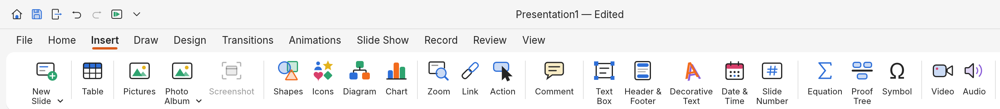
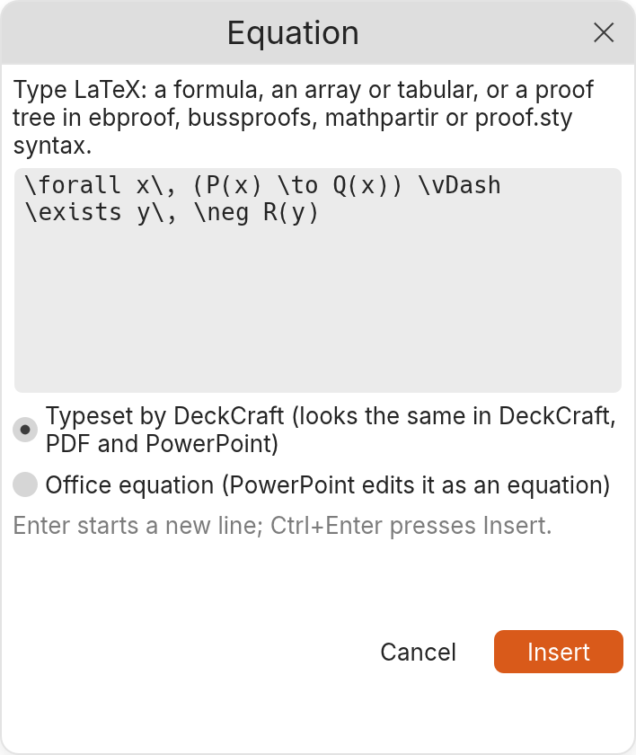
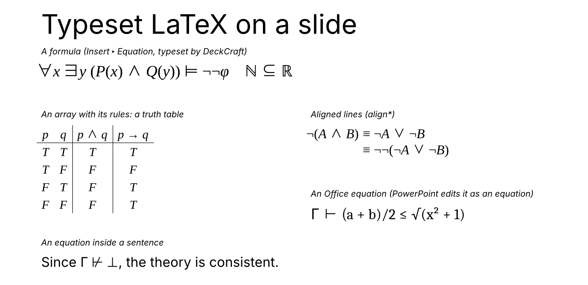
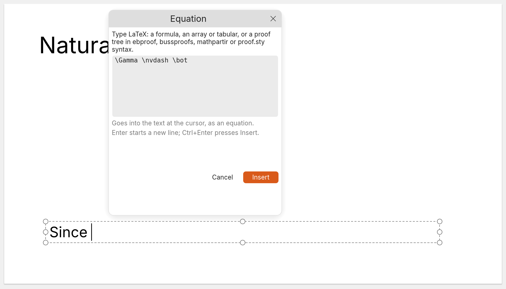
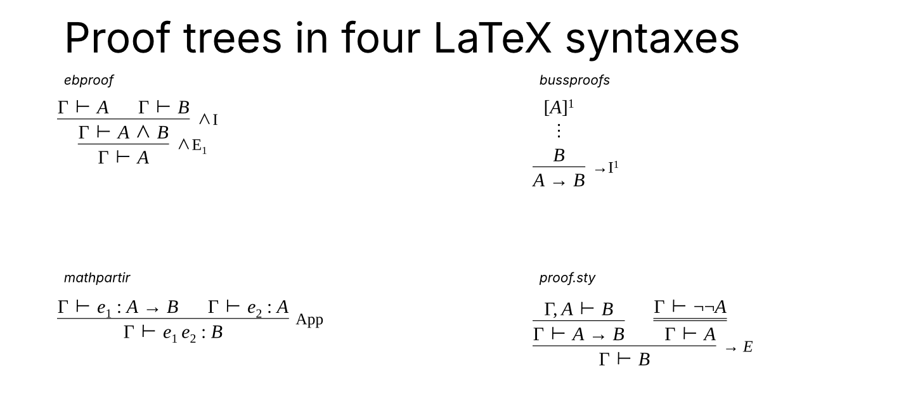

<p align="center">
  <a href="https://getartcraft.com/">
    <picture>
      <source media="(prefers-color-scheme: dark)" srcset="docs/brand/artcraft-logo-white.svg">
      
    </picture>
  </a>
</p>

<p align="center">
  
</p>

<h1 align="center">DeckCraft (Logicians version)</h1>

<p align="center">
  <b>Presentations and slide shows; an open-source, modern presentation and slide designer for logicians, built in pure Rust.</b>
</p>

<p align="center">
  DeckCraft-Logicians is a modified version of DeckCraft for practicioners of logic, mathematics, and computer science. 
  Build decks <strong>native LaTeX support for logical symbols and a visual proof tree editor via the
  ebproofs package</strong>. DeckCraft also allows you to build with themes, layouts, shapes, pictures, tables, charts, transitions and animations,
  open and save .pptx presentation files, and present them full screen. Native on macOS, Windows, Linux
  and FreeBSD, and in the browser. Every button is also a command that the CLI and AI agents
  (through MCP) can drive.
</p>

<p align="center">
  
  
  
  
  <br>
  <a href="https://sonarcloud.io/project/overview?id=storytold_deckcraft"></a>
  <a href="https://coderabbit.ai"></a>
</p>

<p align="center">
  <a href="https://discord.gg/artcraft"></a>
</p>

<p align="center">
  <a href="https://getartcraft.com/apps/deckcraft"><b>DeckCraft on getartcraft.com</b></a> ·
  <a href="https://getartcraft.com/">ArtCraft</a> ·
  <a href="https://getartcraft.com/apps">All Crafting Apps</a>
</p>

> [!NOTE]
> **ArtCraft is a community of artists from all walks of life.** Painters, photographers,
> filmmakers, illustrators, designers, animators, hobbyists, and people who picked up a pencil
> last week. If you make things, you're one of us. **[Come say hi on Discord](https://discord.gg/artcraft).**

<p align="center">
  
</p>

<p align="center">
  <a href="#what-works-today">What works</a> ·
  <a href="#getting-started">Getting started</a> ·
  <a href="#tutorial-latex-equations-and-proof-trees">LaTeX and proof trees</a> ·
  <a href="#agents-cli-and-mcp">Agents, CLI and MCP</a> ·
  <a href="#roadmap">Roadmap</a> ·
  <a href="#downloads">Downloads</a> ·
  <a href="#the-crafting-apps">The Crafting Apps</a> ·
  <a href="#license-and-credits">License</a>
</p>

## What works today

DeckCraft is in alpha, heading for beta (see the [roadmap](ROADMAP.md)).
Today it can:

- **Make decks**: slide masters and eleven layouts with placeholders that inherit position and
  formatting, eight original themes with colour and font schemes, sections, notes, comments,
  headers and footers, custom slide sizes.
- **Draw**: 150+ preset shapes with adjust handles, connectors that stay glued to shapes, freeform,
  curve and scribble tools, merge shapes (union, combine, fragment, intersect, subtract), gradient,
  picture and pattern fills, outlines with dashes and arrowheads, shadows, glow, soft edges and
  reflections.
- **Write**: in-place text editing with full font and paragraph formatting, bullets and numbering,
  columns, autofit, vertical text, fields and hyperlinks.
- **Add content**: pictures with crop and corrections, tables with styles, charts, SmartArt basics,
  audio and video (MP3, AAC, FLAC, ALAC, Ogg, Opus, WAV, AIFF; H.264, HEVC, VP9, AV1).
- **Typeset math and logic**: LaTeX formulas, arrays and proof trees (ebproof, bussproofs,
  mathpartir, proof.sty), equations inside a line of text, and a visual Proof Tree builder (see the
  [tutorial](#tutorial-latex-equations-and-proof-trees)).
- **Present**: transitions (including Morph), entrance/emphasis/exit and motion-path animations,
  by-paragraph builds, full-screen slide show, presenter view, pen, rehearse timings, media playback.
- **Exchange files**: open and save .pptx presentations, export PDF (slides, notes pages, handouts
  with selectable text), PNG/JPEG, an animated GIF of the deck and outlines. Unsaved work is kept by AutoRecover.
- **Automate**: 200+ commands with undo, all scriptable from the CLI, a JSON control channel and an
  MCP server for AI agents.

<table>
  <tr>
    <td width="50%"><br><sub>Shape Format contextual tab and selection handles</sub></td>
    <td width="50%"><br><sub>Format Shape pane: gradient type, direction and stops</sub></td>
  </tr>
  <tr>
    <td width="50%"><br><sub>Slide Sorter with each slide's transition</sub></td>
    <td width="50%"><br><sub>Dark mode, with a native chart</sub></td>
  </tr>
</table>

<p align="center">
  <br>
  <sub>The built-in sample deck, rendered by <code>deckcraft-cli render --sample --all</code></sub>
</p>

## Getting started

PDF export uses the shared `craft-pdf` writer with import features disabled. See
[`crates/pdf/README.md`](crates/pdf/README.md) for the dependency and validation requirements.

```sh
git clone https://github.com/storytold/deckcraft
cd deckcraft
cargo run --release -p deckcraft-cli -- render --sample --all --scale 1 out/
```

On Linux, the build also needs the ALSA headers for slide-show sound: `alsa-lib-devel` on Fedora,
`libasound2-dev` on Debian and Ubuntu, `alsa-lib` on Arch. Without them it stops at `alsa-sys`.

Fonts come from [craft-fonts](https://github.com/storytold/craft-fonts): clone it next to this repo
(`../craft-fonts`) and local builds pick it up automatically; without it DeckCraft uses your system
fonts.

Each [GitHub release](https://github.com/storytold/deckcraft/releases) has ready-made builds, on Linux as
an AppImage, a `.deb`, an `.rpm` and a tarball. On Gentoo, the community [::snakebyte
overlay](https://github.com/switch87/snakebyte-overlay) packages the Linux release as
`app-office/deckcraft-bin` (not maintained by the DeckCraft team):

```sh
eselect repository add snakebyte git https://github.com/switch87/snakebyte-overlay.git
emaint sync -r snakebyte
echo 'app-office/deckcraft-bin ~amd64' >> /etc/portage/package.accept_keywords/deckcraft
emerge --ask app-office/deckcraft-bin
```

### Logs

The desktop app writes its `log` records to standard error and to `logs/deckcraft.log` in the
settings directory, beside `ui.json` and `prefs.json` (Linux `~/.config/deckcraft/logs/`, or
`$XDG_CONFIG_HOME/deckcraft/logs/`; macOS `~/Library/Application Support/DeckCraft/logs/`; Windows
`%APPDATA%\DeckCraft\logs\`). A start from a desktop menu or the Dock has no terminal, so this file
is what to attach to a bug report: the crash guard's panic report, a failed crash-recovery save,
Parts skipped on import and audio output problems land there. Each launch moves the
previous log to `deckcraft.1.log` (and that one to `deckcraft.2.log`), so the log of a run that
crashed survives the next start. The file stops growing at 16 MiB. `--version` writes no file.

| Variable | Effect |
|---|---|
| `RUST_LOG` | Log levels for standard error and the log file. Default: `info` for DeckCraft's own crates, `warn` for everything else. env_logger-style directives replace that, e.g. `RUST_LOG=debug`, `RUST_LOG=warn,deckcraft_pptx=trace` or `RUST_LOG=info,wgpu_core=warn`; a directive ending in `*` covers every target starting with it (`deckcraft*=debug`). |

The logger is `apps/deckcraft/src/logging.rs`; the realtime audio callback does not log. The web
app logs to the browser console instead.

## Tutorial: LaTeX equations and proof trees

DeckCraft sets LaTeX itself: formulas, arrays and tables, aligned derivations and proof trees
become ordinary slide shapes (text boxes and rules in a group). They look the same in DeckCraft,
in exported PDFs and in PowerPoint, and they keep their LaTeX, so you can open them again and
change them. This tutorial walks through each part. Shortcuts are written with Ctrl; on macOS use ⌘.

<p align="center">
  <br>
  <sub>Everything starts on the Insert tab: <b>Equation</b> and <b>Proof Tree</b></sub>
</p>

### 1. Insert a formula

1. Choose **Insert ▸ Equation**.
2. Type LaTeX, with or without `$…$`, `\[…\]` or `\begin{equation}`. **Enter** starts a new line,
   so long sources stay readable; **Ctrl+Enter** presses **Insert**.
3. Pick how it is inserted:
   - **Typeset by DeckCraft** (the default) sets it as shapes. Use this for logic, arrays and proofs.
   - **Office equation** inserts a native equation that PowerPoint edits in its own equation editor.
     DeckCraft draws its linear form (`(a+b)/2`), so prefer typeset when the slide is shown from
     DeckCraft or exported to PDF.

<p align="center">
  
</p>

The new shape lands in the middle of the slide, in 24 pt Liberation Serif; drag it where you want
it. The slide below was made this way (the captions are ordinary text boxes):

<p align="center">
  
</p>

What you can write:

| | Examples |
|---|---|
| Logic | `\forall \exists \neg \lnot \wedge \land \vee \lor \to \rightarrow \leftrightarrow \iff \implies \vdash \nvdash \vDash \models \Vdash \bot \top \Box \Diamond \equiv`, and any relation negated with `\not` (`\not\models` gives ⊭) |
| Sets and order | `\in \notin \subseteq \subset \cup \cap \emptyset \setminus \leq \geq \neq \sqsubseteq \prec` |
| Letters | Greek (`\alpha … \Omega`, `\varphi`), `\mathbb{N}`, `\mathcal{L}`, `\mathfrak{g}`, `\mathbf{v}`, `\mathsf{Set}`, `\mathrm{d}`, `\text{if and only if}` |
| Structure | `x^2`, `x_i`, `\sum_{i=1}^{n}`, `\frac{a}{b}`, `\sqrt[3]{x}`, `\hat{x}`, `\bar{y}`, `\overset{\text{def}}{=}`, `\underset{x \in X}{\min}`, `\stackrel{?}{=}` |
| Spacing | `\,` `\:` `\;` `\quad` `\qquad` `~`; operators, relations and quantifiers are spaced as TeX spaces them |
| Grids | `array` (with `\|` column rules, `\hline`, `\cline{2-3}`, `\multicolumn`), `tabular`, `align`/`align*`/`aligned`/`alignat`/`split`/`eqnarray`, `gather`/`multline` |

The truth table above is:

```latex
\begin{array}{cc|c|c}
  p & q & p \wedge q & p \to q \\ \hline
  T & T & T & T \\
  T & F & F & F \\
  F & T & F & T \\
  F & F & F & T
\end{array}
```

### 2. Put an equation inside a sentence

While you are typing in a text box, **Insert ▸ Equation** puts the equation into the text at the
cursor, in the text's size. The dialog says so ("Goes into the text at the cursor"). Text you type
after it keeps the sentence's own font. The last line of the slide above, *Since Γ ⊬ ⊥, the theory
is consistent*, was typed this way.

<p align="center">
  
</p>

An inline equation is an Office equation, so PowerPoint can edit it too. A proof tree or an array
can't sit in a line of text: those are inserted as their own shape. To change an inline equation
later, select its text box (click its border), choose **Insert ▸ Equation** and keep **Change the
selected one** ticked: the dialog opens on the box's first equation.

### 3. Write proof trees in LaTeX

Paste a proof tree into **Insert ▸ Equation** in any of four common syntaxes. DeckCraft draws
the rules, labels and premises, and centres each conclusion under its premises.

<p align="center">
  
</p>

**ebproof**: `\hypo{…}` for a leaf, `\infer N[label]{conclusion}` for a rule with N premises
(`\infer0` is an axiom, `\infer{10}` takes ten), and the `left label`, `right label`,
`rule style=double|dashed|no rule` and `template` options. The older capitalised `\Hypo` and
`\Infer` work too, and the `prooftree` environment is optional.

```latex
\begin{prooftree}
  \hypo{\Gamma \vdash A}
  \hypo{\Gamma \vdash B}
  \infer2[$\wedge$I]{\Gamma \vdash A \wedge B}
  \infer1[$\wedge$E$_1$]{\Gamma \vdash A}
\end{prooftree}
```

**bussproofs**: `\AxiomC`, `\UnaryInfC` … `\QuinaryInfC` (and the short `\AXC`, `\UIC`, `\BIC`,
`\TIC`), `\LeftLabel`, `\RightLabel`, `\noLine`, `\doubleLine`, `\dashedLine`, `\DisplayProof`.

```latex
\AxiomC{$[A]^1$}
\noLine \UnaryInfC{$\vdots$}
\noLine \UnaryInfC{$B$}
\RightLabel{$\to$I$^1$}
\UnaryInfC{$A \to B$}
\DisplayProof
```

**mathpartir**: `\inferrule{premises separated by \\}{conclusion}` and
`\inferrule*[right=…, left=…]{…}{…}`.

```latex
\inferrule*[right=App]{\Gamma \vdash e_1 : A \to B \\ \Gamma \vdash e_2 : A}{\Gamma \vdash e_1\,e_2 : B}
```

**proof.sty**: `\infer[label]{conclusion}{premise & premise}`, `\infer=` for a double rule and
`\deduce` for a rule-less step.

```latex
\infer[\to E]{\Gamma \vdash B}{
  \infer{\Gamma \vdash A \to B}{\Gamma, A \vdash B} &
  \infer={\Gamma \vdash A}{\Gamma \vdash \neg\neg A}}
```

Several proofs in one source (for example two `prooftree` environments) are set side by side.

### 4. Build a proof tree visually

**Insert ▸ Proof Tree** opens the Proof Tree builder. You build the tree step by step and see it
typeset as you go; the builder writes the ebproof LaTeX for you.

<p align="center">
  
</p>

- **Canvas** (middle): click a step to select it, double-click to edit its statement, drag a step
  onto another to move it (onto the left or right quarter to put it beside, elsewhere to make it a
  premise). The selected step has buttons around it: **+** above adds a premise, **+** left and
  right add one beside, **+** below adds a step under it, **×** removes it.
- **Steps** (top right): the same tree as an outline; click to select.
- **Selected step**: its **Statement** in LaTeX (math by default; tick **Set as text, not math**
  for prose), a strip of common logic symbols to click in, its **Kind** (hypothesis, axiom or
  inference), its **Rule** (single, double, dashed, no rule, or an ellipsis ⋮) and its **Right
  label** and **Left label**. Labels are text: put math in `$…$`, as in `$\to$E`.
- **Toolbar**: the same edits as buttons, plus **Undo**/**Redo**, **Copy**/**Cut**/**Paste** of
  whole branches, **Templates**, zoom, and the **Size** and **Font** the proof is set in.
- **Footer**: **Insert** (or **Update** when you opened an existing proof), **Insert as new** to
  keep the original and add a copy, and **Cancel** (it asks before throwing changes away).

**Try it**: modus ponens from the keyboard.

1. **Insert ▸ Proof Tree**. The new proof starts in its conclusion's statement: type `B`.
2. **Ctrl+↑** adds a premise and puts you in it. Type `A \to B`.
3. **Tab** adds the next premise on the right. Type `A`.
4. Click the conclusion **B** and type `$\to$E` into **Right label**.
5. **Ctrl+Enter** inserts the proof on the slide.

| Keys | Does |
|---|---|
| Ctrl+↑ / Ctrl+↓ | Add a premise above the selected step / a step below it |
| Ctrl+← / Ctrl+→ | Add a premise beside it, on the left / right |
| Tab (while typing a statement) | Add the next premise on the right |
| ↑ ↓ ← → | Select the first premise, the step below, or the neighbour on either side |
| Enter or F2 | Edit the selected step's statement |
| Esc | In a statement: put it back as it was and leave the field. Elsewhere: close the builder |
| Delete | Remove the step; its premises take its place |
| Shift+Delete | Delete the step and everything above it |
| Alt+← / Alt+→ | Swap the step with its neighbour |
| Ctrl+Z, Ctrl+Shift+Z or Ctrl+Y | Undo, redo (the builder keeps its own history) |
| Ctrl+C / Ctrl+X / Ctrl+V | Copy, cut, paste a branch (pasted above the selected step) |
| Ctrl+Enter | Insert or Update, and close |

**Templates** insert a whole natural-deduction rule with placeholder statements: into an empty
step, above the selected step, or as a new tree. There are the introduction and elimination rules
for ∧, ∨, →, ¬, ∀ and ∃, ⊥ elimination, axiom, cut, weakening and a ⋮ derivation.

<p align="center">
  
</p>

The **LaTeX (ebproof)** pane under the canvas shows the source the builder writes. You can also
edit it there and the tree follows; **Copy LaTeX** puts it on the clipboard for your paper, and
**Edit as LaTeX…** moves to the Equation dialog. A proof first written in bussproofs, mathpartir or
proof.sty is rewritten in ebproof when you update it from the builder (the builder tells you so,
and says what it can't keep).

<p align="center">
  
</p>

### 5. Edit and resize

- **Double-click** a typeset formula or array to reopen it in the Equation dialog, with **Change
  the selected one** ticked so **Update** replaces it in place (untick it to insert a new copy).
  Double-click a proof tree to open it in the Proof Tree builder; from the Equation dialog,
  **Open in Proof Tree builder** does the same. Each change is one step of the deck's undo.
- **Resize** a typeset shape with a corner handle. It keeps its proportions and is set again at the
  new size, so the text and rules stay sharp rather than stretched, and the new size is kept for
  the next edit.

<p align="center">
  
</p>

### 6. From scripts and agents

The same features are commands, so `deckcraft-cli`, the control channel and MCP agents use them
too:

```sh
deckcraft-cli run \
  --cmd 'slide.new={"layout":"titleOnly","title":"Modus ponens"}' \
  --cmd 'insert.latex={"latex":"\\hypo{A \\to B}\\hypo{A}\\infer2[$\\to$E]{B}","size":32,"rect":[80,160,0,0]}' \
  --cmd 'latex.get' \
  --print --save mp.deckcraft --export mp.png
```

| Command | Parameters | Does |
|---|---|---|
| `insert.latex` | `latex`, `rect?` (x and y place it), `size?` (24), `font?` (Liberation Serif; `""` for the theme's) | Typesets a formula, grid or proof; returns its `id` and `kind` |
| `insert.equation` | `latex`, `rect?`, `size?` | Inserts an Office equation; while text is being edited, inline at the cursor |
| `latex.get` | `id?` | The selected LaTeX shape's `latex`, `kind`, `size` and `font` |
| `latex.set` | `latex`, `id?`, `size?`, `font?` | Sets a LaTeX shape again in place, or rewrites an equation |

`deckcraft-cli describe insert.latex` prints the full parameter description.

### Limitations

- A formula is set on one line: `\frac{a}{b}` reads `a/b`, roots use √ and ∛, `\overset`,
  `\underset` and `\stackrel` sit as superscripts and subscripts, and matrices are written
  row by row. Stacked fractions, big delimiters and environments such as `cases` and `pmatrix`
  are not laid out in two dimensions yet.
- Office equations are drawn in their linear form inside DeckCraft. PowerPoint shows them in full.
- amssymb's names (`\vDash`, `\Vdash`, `\nvdash`, `\Box`, `\Diamond`, `\land`, `\lor` and many
  relations) and `\underset` over a function name (`\underset{x}{\min} f(x)`) need the craft-math
  in DeckCraft's next craft-libs update. A build against an older craft-libs shows those names as
  written.
- Symbols Liberation Serif doesn't have (such as ⊢, ⊨, ∧) come from DeckCraft's fallback fonts.
  Choose another font with the builder's **Font** field or the `font` parameter.
- A source is limited to 20,000 characters, and a proof to 2,000 steps and 160 levels.

## Agents, CLI and MCP

Every action in DeckCraft is a command with a stable id, so people, scripts and AI agents use the
same verbs:

```sh
deckcraft-cli commands format.          # list commands
deckcraft-cli run --sample --cmd 'slide.new={"layout":"titleOnly","title":"Hello"}' --save hello.deckcraft
deckcraft-cli mcp                       # MCP server over stdio (headless)
deckcraft-cli mcp --connect 7990        # drive the running app (deckcraft --control 7990)
deckcraft-cli mcp --automation-read-root DIR --automation-write-root DIR   # confine the headless agent to folders
```

## Roadmap

DeckCraft is in **alpha**. It covers **84% of the features tracked in [`docs/target-app-parity.md`](docs/target-app-parity.md) by breadth** (92% of the core
ones, measured) and is about **55% ready for real work across all tracked capabilities** (estimated).
See [ROADMAP.md](ROADMAP.md) for the stage, numbers by dimension and what's next,
[docs/target-app-parity.md](docs/target-app-parity.md) for the full assessment,
[docs/gaps.md](docs/gaps.md) for every known shortfall and
[docs/parity-checklist.md](docs/parity-checklist.md) for the feature-by-feature checklist.

## Downloads

**Download DeckCraft** from GitHub: the [latest release](https://github.com/storytold/deckcraft/releases/latest) has every build listed below, and [all releases](https://github.com/storytold/deckcraft/releases) has earlier versions and their notes. `<ver>` in the file names is the version number, and `SHA256SUMS.txt` lists a checksum for every file.

### Windows

| Build | Installer | Portable |
|---|---|---|
| x64 (64-bit Intel/AMD) | `deckcraft-<ver>-windows-x64.msi` | `deckcraft-<ver>-windows-x64-portable.zip` |
| arm64 (Snapdragon and other ARM PCs) | `deckcraft-<ver>-windows-arm64.msi` | `deckcraft-<ver>-windows-arm64-portable.zip` |
| x86 (32-bit) | `deckcraft-<ver>-windows-x86.msi` | `deckcraft-<ver>-windows-x86-portable.zip` |

Installers and executables are code-signed.

**If the app doesn't open on Windows:** the desktop app initializes only DirectX 12 by default.
Letting wgpu also create an OpenGL instance can crash some graphics drivers (AMD's
`atio6axx.dll`) before the window appears, so the app would flash in Task Manager and quit.
`WGPU_BACKEND` overrides the default for troubleshooting (for example `dx12` or `vulkan`). In
PowerShell, from the folder containing the executable:

```powershell
$env:WGPU_BACKEND = "vulkan"
& .\deckcraft.exe
Remove-Item Env:WGPU_BACKEND                     # restore the default for later launches
```

An explicit `gl` override can bring the driver crash back on affected systems. The macOS, Linux
and web backend defaults are unchanged.

DirectX 12 shaders are compiled with FXC, which is part of Windows, so no `dxcompiler.dll` or
`dxil.dll` is needed ("Parent device is lost" at start, #153). `$env:WGPU_DX12_COMPILER = "dxc"`
(or `"auto"`) selects wgpu's DXC handling again for troubleshooting.

### macOS

| Build | File | Notes |
|---|---|---|
| App, universal (Apple silicon + Intel) | `deckcraft-<ver>-macos-universal.dmg` | Signed and notarized |
| Command-line tool, universal | `deckcraft-cli-<ver>-macos-universal.zip` | Signed and notarized |

### Linux

| Format | x86_64 | aarch64 (ARM64) | Notes |
|---|---|---|---|
| AppImage | `deckcraft-<ver>-linux-x86_64.AppImage` | `deckcraft-<ver>-linux-aarch64.AppImage` | Runs anywhere; updates itself with [AppImageUpdate](https://github.com/AppImageCommunity/AppImageUpdate) (`.zsync` files) |
| Flatpak | `deckcraft-<ver>-linux-x86_64.flatpak` | `deckcraft-<ver>-linux-aarch64.flatpak` | Sandboxed; `flatpak install --user <file>` |
| Debian/Ubuntu | `deckcraft-<ver>-linux-x86_64.deb` | `deckcraft-<ver>-linux-aarch64.deb` | |
| Fedora/RHEL/openSUSE | `deckcraft-<ver>-linux-x86_64.rpm` | `deckcraft-<ver>-linux-aarch64.rpm` | |
| Tarball | `deckcraft-<ver>-linux-x86_64.tar.gz` | `deckcraft-<ver>-linux-aarch64.tar.gz` | Unpack anywhere |

RISC-V 64 (riscv64): `deckcraft-<ver>-linux-riscv64.tar.gz`, a tarball only (cross-compiled; needs glibc 2.39+, e.g. Ubuntu 24.04+).

**Runtime libraries.** The window-system, GPU and file-dialog libraries DeckCraft needs are opened
when the app starts (`dlopen` through `x11-dl`, `xkbcommon-dl`, `ash`, `glutin` and `rfd`) instead
of being linked in, so `ldd` shows none of them: an install that satisfies the linked dependencies
can still fail at start-up with a loader error and no hint of what to install. Only
`libasound.so.2` (slide-show sound) is a hard link-time dependency, and only of the `deckcraft`
GUI — `deckcraft-cli` uses neither sound nor a display. The `.deb` and `.rpm` declare the set in
`packaging/linux/nfpm.yaml`; a tarball install or a musl system has to provide it itself:

```sh
apk add libx11 libxcursor libxrandr libxi libxkbcommon xkeyboard-config \
        wayland-libs-client alsa-lib \
        vulkan-loader mesa-vulkan-swrast \
        mesa-gl mesa-egl mesa-dri-gallium \
        xdg-desktop-portal
```

Alpine Linux `v3.22` names above; Void's musl variant uses the same `/lib/ld-musl-x86_64.so.1`
loader and the same libraries as `libX11 libXcursor libXrandr libXi libxkbcommon xkeyboard-config
wayland alsa-lib vulkan-loader mesa xdg-desktop-portal`. There is no musl build among the release
artifacts yet — this is what a build from source on musl needs at run time, and what a future musl
artifact will need (#954).

- `mesa-vulkan-swrast` is the software Vulkan driver: it runs anywhere, VMs and containers
  included. On a real GPU install your vendor's driver instead (`mesa-vulkan-intel`,
  `mesa-vulkan-ati`, `mesa-vulkan-nouveau`, …).
- Without Vulkan the app falls back to CPU rendering through Mesa's GL drivers. It works, but
  slowly — a driver limit, not a DeckCraft bug.
- `xdg-desktop-portal` (with `xdg-desktop-portal-gtk` or `-kde`; `-wlr` has no file chooser, so
  on wlroots compositors install `zenity`) is what the Open and Save dialogs talk to; `xkeyboard-config` holds the XKB keyboard data `libxkbcommon` reads.
- fontconfig and freetype are not needed: DeckCraft reads `/usr/share/fonts` itself and embeds its
  presentation fonts.

Building from source on musl also needs `build-base pkgconf alsa-lib-dev` (`alsa-lib-dev` is the
ALSA headers).

### FreeBSD

| Build | File |
|---|---|
| x86_64 | `deckcraft-<ver>-freebsd-x86_64.tar.gz` |

### Web (WebAssembly)

| Build | File | Notes |
|---|---|---|
| Static site | `deckcraft-web-<ver>.zip` | Runs in a modern browser; host it on any static server |

## The Crafting Apps

DeckCraft is one of the **Crafting Apps**: free, open-source creative tools from the
[ArtCraft](https://getartcraft.com/) team, each written from scratch in Rust and each able to
stand on its own.

| | App | What it's for | Code | Learn more |
|:-:|---|---|---|---|
|  | **PhotoCraft** | Image editing: layers, masks, type and real PSD files | [GitHub](https://github.com/storytold/photocraft) | [Website](https://getartcraft.com/apps/photocraft) |
|  | **VectorCraft** | Vector illustration | [GitHub](https://github.com/storytold/vectorcraft) | [Website](https://getartcraft.com/apps/vectorcraft) |
|  | **FilmCraft** | Video editing, color and sound | [GitHub](https://github.com/storytold/filmcraft) | [Website](https://getartcraft.com/apps/filmcraft) |
|  | **LightCraft** | Photo library and raw development | [GitHub](https://github.com/storytold/lightcraft) | [Website](https://getartcraft.com/apps/lightcraft) |
|  | **PdfCraft** | Reading, organizing and protecting PDFs | [GitHub](https://github.com/storytold/pdfcraft) | [Website](https://getartcraft.com/apps/pdfcraft) |
|  | **EffectCraft** | Motion graphics and visual effects | [GitHub](https://github.com/storytold/effectcraft) | [Website](https://getartcraft.com/apps/effectcraft) |
|  | **DesignCraft** | Page layout and publishing | [GitHub](https://github.com/storytold/designcraft) | [Website](https://getartcraft.com/apps/designcraft) |
|  | **FigCraft** | Interface design and prototyping | [GitHub](https://github.com/storytold/figcraft) | [Website](https://getartcraft.com/apps/figcraft) |
|  | **WordCraft** | Word processing and documents | [GitHub](https://github.com/storytold/wordcraft) | [Website](https://getartcraft.com/apps/wordcraft) |
|  | **SoundCraft** | Audio recording and editing | [GitHub](https://github.com/storytold/soundcraft) | [Website](https://getartcraft.com/apps/soundcraft) |
|  | **DeckCraft** | Presentations and slide decks | [GitHub](https://github.com/storytold/deckcraft) | [Website](https://getartcraft.com/apps/deckcraft) |
|  | **CADCraft** | Computer-aided design | [GitHub](https://github.com/storytold/cadcraft) | [Website](https://getartcraft.com/apps/cadcraft) |
|  | **GridCraft** | Spreadsheets and data | [GitHub](https://github.com/storytold/gridcraft) | [Website](https://getartcraft.com/apps/gridcraft) |
|  | **TextureCraft** | 3D texture painting | [GitHub](https://github.com/storytold/texturecraft) | [Website](https://getartcraft.com/apps/texturecraft) |
|  | **Craft Anything** | See how any software works, then build your own | [GitHub](https://github.com/storytold/craft-anything) | [Website](https://getartcraft.com/apps/craft-anything) |
|  | **SolidCraft** | Parametric 3D CAD by Tangency Labs (community app) | [GitHub](https://github.com/tangency-labs/solidcraft) | |

And [**ArtCraft**](https://getartcraft.com/) itself, our AI image and video studio for artists who want real control.

<br>

<p align="center">
  <a href="https://discord.gg/artcraft"></a>
</p>

<h3 align="center">Come make things with us</h3>

<p align="center">
  Our Discord is where artists of every kind hang out: people who paint, shoot, draw, cut film,
  set type, and people still figuring out what they like to make. Share what you're working on,
  ask for help, tell us what's broken, or tell us what you wish these tools could do.
  Whatever your medium and however long you've been at it, you're welcome here.
</p>

<p align="center">
  <a href="https://discord.gg/artcraft"><b>discord.gg/artcraft</b></a> ·
  <a href="https://getartcraft.com/">getartcraft.com</a> ·
  <a href="https://getartcraft.com/apps">The Crafting Apps</a> ·
  <a href="https://getartcraft.com/apps/deckcraft">DeckCraft</a>
</p>

## License and credits

DeckCraft is dual-licensed under [MIT](LICENSE-MIT) or [Apache-2.0](LICENSE-APACHE), at your option.
Copyright (c) 2026 ArtCraft Team and the DeckCraft contributors. Required notices are in [NOTICE](NOTICE).

Bundled fonts, icons, images and other assets keep their own open licenses; each one is listed
with its author, source and license in [ATTRIBUTION.md](ATTRIBUTION.md).

DeckCraft's themes, layouts, shape geometry, icons and sample decks are original work, drawn or
generated in code; no proprietary artwork, fonts, themes or templates are used.

The ArtCraft name, wordmark and logos in [`docs/brand/`](docs/brand/) are trademarks of the
ArtCraft Team and are not covered by this license. They may be used only unmodified, and only as
part of this repository and DeckCraft, under [`docs/brand/LICENSE-brand.txt`](docs/brand/LICENSE-brand.txt).
Forks and modified versions must remove them.

<p align="center">
  <a href="https://getartcraft.com/"></a><br>
  <sub>Made by the <a href="https://getartcraft.com/">ArtCraft</a> team and community.</sub>
</p>
